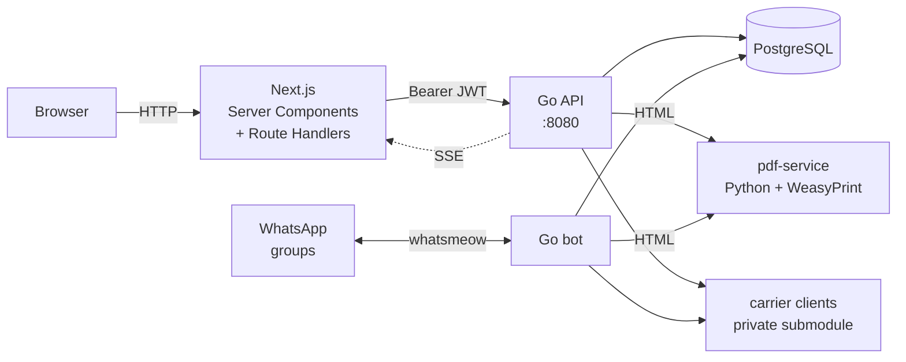

# M80

Back-office system for travel agencies that issue airline tickets with **loyalty miles**: a web
panel and a WhatsApp bot working on the same database. It has been running in production since
August 2026, with real issuances and real money recorded through it.

---

## The problem

A miles agency runs inside a WhatsApp group. Whoever issues a ticket buys it on the loyalty
program's site and tells the group in a short message, written in a dialect the team made up:
program, locator, origin, miles, price per thousand miles, taxes, and which account the miles came
from.

That message used to be the only record of the sale. Someone later had to reread it, copy it into
a spreadsheet, work out whose account "Heraldo" was, check that the numbers added up, and build the
customer's ticket by hand. What got lost along the way was traceability (who issued what, and
when), consistency (the same alias spelled three ways), arithmetic checks, and tracking who had
already paid: the customer for the ticket, and the agency for the miles.

**M80 keeps the WhatsApp group as the interface.** It is the team's habit, and swapping it for a
form would trade speed for bureaucracy. **What changes is that every message becomes data.** The
bot reads the group, validates the message, stores the issuance, fetches the real flight data and
sends back the ticket as a PDF. The panel shows everything in real time, and it is where things get
corrected, filtered, charged and exported.

## How it works, by example

The issuer posts to a monitored group:

```
EMISSAO - SMILES - IWBEQP
CNF - MACHADO
31k * 16,5 + 189,22 tx = 700,72
Heraldo
ACORDO
```

The message has five lines:

1. The program and the locators.
2. The origin and whatever the airline requires (surname, purchase number).
3. The numbers.
4. The account, the administrator and the agency.
5. An optional note code.

It has no `!` prefix because it is not a command. It is the message the team was already sending
before the bot existed.

From there:

1. **Gate.** The chat must be approved in the panel and the sender must be registered. The bot
   ignores unknown numbers.
2. **Parser** (`internal/bot/emissao_parse.go`). Pure string work, no database. It checks the
   arithmetic on line 3 against the declared total, so a `3` typed instead of an `8` is caught
   before it becomes a record.
3. **Resolution** (`internal/bot/emissao_resolve.go`). "SMILES" becomes the program, "Heraldo"
   becomes the account, and "MACHADO" becomes the surname the airline asks for. An unknown alias
   does not reject the issuance: it creates an incomplete record that is finished later in the
   panel.
4. **Transactional write.** The issuance, its passengers, flights and the matching sale are stored
   all or nothing.
5. **Booking data.** The real reservation (passengers, segments, seats, baggage) is fetched from
   the airline.
6. **SSE.** The row shows up on the Issuances board of everyone who has the screen open, right
   away.
7. **PDF.** The customer's ticket is rendered from the reservation data.

The bot also understands `ALTERACAO` (change), `CANCELAMENTO` (cancellation) and `DELETAR`
(delete), and reacts to WhatsApp's **native edit and delete**: fixing the original message on the
phone fixes the issuance in the database.

Beyond the bot, the panel covers customers and payments, loyalty accounts and their balances,
FIFO costing of point batches, supplier and customer reports, promotions, and a browser extension
for the staff.

## Layered architecture

Each layer works without the next one. That rule drives the whole design.

| Layer | What it is | Why it stands alone |
| --- | --- | --- |
| **1 — Core** | Web panel: auth, records, manual issuance CRUD, sales, dashboard | It is a complete management system even with the bot turned off |
| **2 — Bot** | Reads the monitored groups and stores issuances automatically | Without booking data it still saves the issuance with what the message carried |
| **3 — Booking data** | Enriches the issuance with the real reservation and makes the ticket possible | Optional per issuance; a failure never loses the record |



Two rules the diagram hides, which apply to any new code:

- **The browser never talks to the Go backend directly.** `BACKEND_URL` is server-only, and the Go
  API requires an `Authorization` header, which neither `EventSource` nor `<a download>` can send.
  Every call that starts in the client goes through a Route Handler in `frontend/src/app/api/`,
  which reads the cookie and turns it into a Bearer token.
- **SSE is the only real-time channel.** The broker lives in `backend/internal/events`. Do not open
  another `EventSource`; reuse the `useSSE` hook.

### Private submodules

Code that talks to third-party systems (airline and loyalty-program clients, the promotion
enrolment service, the panel pieces that link loyalty accounts, and the staff browser extension)
lives in three private repositories, mounted as submodules:

| Path | Repository |
| --- | --- |
| `backend/carriers` | `murandido/m80-carriers` |
| `frontend/src/carriers` | `murandido/m80-panel-carriers` |
| `extension` | `murandido/m80-extension` |

This repository keeps the contracts they implement (`backend/internal/booking`) and the
orchestration on top of them (`backend/internal/*sync`, `backend/internal/promotion`). **Without
access to the submodules the backend does not compile**, so a public clone is for reading.

### Services

| Service | Role | Port (dev) |
| --- | --- | --- |
| `frontend` (native, outside Docker) | Next.js panel | 3000 |
| `api-dev` | REST API (`cmd/api`) | 8080 |
| `whatsapp-bot-dev` | Persistent WhatsApp client (`cmd/bot`) | internal (8081) |
| `promo-service-dev` | Browser that enrols CPFs in promotions | internal (8082) |
| `pdf-service-dev` | HTML → PDF | 5000 |
| `db-dev` | PostgreSQL | 5432 |

The bot is **not** a server receiving webhooks. It is a multi-device client connected to WhatsApp
Web, with a queue per chat and a lock per locator (PNR). The API and the bot talk over an internal
HTTP listener that is never published on the host.

### Stack

- **Backend:** Go 1.26, chi, GORM, golang-migrate, whatsmeow
- **Frontend:** Next.js 16 (App Router), React 19, Tailwind 4, shadcn/ui, Zod + react-hook-form
- **Database:** PostgreSQL 16. It also holds the paired WhatsApp session, which whatsmeow stores
  there.
- **PDF:** Python 3.12 + Flask + WeasyPrint, as an internal sidecar
- **Infra:** Docker Compose with `dev` / `test` / `prod` profiles, driven by a `Makefile`; Caddy in
  front; arm64 images on GHCR

> No JS monorepo tooling (Lerna, Nx, Turborepo), on purpose. The root `Makefile` is the
> orchestrator.

---

## Running locally

### Prerequisites

| Tool | Version | Used for |
| --- | --- | --- |
| Docker + Compose v2 | — | Backend, bot, pdf-service and database |
| Node | 24+ | Frontend |
| pnpm | 10+ | Frontend package manager |
| Go | 1.26+ | Only for the commit hooks (the backend runs in containers) |
| make | — | Orchestration |

### 1. Submodules

```bash
make init
```

This requires access to the private repositories. Without it, stop here: the backend does not build.

### 2. Environment variables

```bash
cp backend/.env.sample backend/.env
cp frontend/.env.sample frontend/.env
```

In `backend/.env`, fill in the `_DEV` block. The `_TEST` and `_PROD` blocks only matter when you run
those profiles.

| Variable | Development value |
| --- | --- |
| `DB_USER_DEV` | `postgres` |
| `DB_PASSWORD_DEV` | any password |
| `DB_NAME_DEV` | `m80` |
| `DB_HOST_DEV` | `m-80-db-dev` (the container name, resolved on the Compose network) |
| `DB_PORT_DEV` | `5432` |
| `JWT_SECRET_DEV` | any long string |
| `ENCRYPTION_KEY_DEV` | **`openssl rand -hex 32`** |
| `CPF_INDEX_KEY_DEV` | **`openssl rand -hex 32`** |

**`ENCRYPTION_KEY` must be 64 hex characters** (32 bytes, AES-256; see
`backend/internal/utils/crypto.go`). With an invalid value, encrypted fields fail on write.

In `frontend/.env`:

```
NODE_ENV=development
BACKEND_URL=http://localhost:8080
```

### 3. Commit hooks (once per clone)

```bash
go install github.com/evilmartians/lefthook@latest
go install golang.org/x/tools/cmd/goimports@latest
lefthook install
```

**Make sure `$(go env GOPATH)/bin` is on your `PATH`.** If `lefthook` is not found at commit time,
the hook only prints `"Can't find lefthook in PATH"` and lets the commit through without running
anything.

### 4. Start

```bash
make dev
```

This starts the backend in Docker (API, bot, pdf-service, Postgres) and the Next dev server.
Migrations run on their own at startup; there is no manual migration step.

| Where | URL |
| --- | --- |
| Panel | http://localhost:3000 |
| API | http://localhost:8080 |
| Swagger | http://localhost:8080/swagger/index.html |

### 5. First login

If the `users` table is empty on first start, the API creates a default admin and **prints the
credentials to the log**. Check `make back-logs`, or the bootstrap block in
`backend/cmd/api/main.go`. Airports, airlines and loyalty programs are seeded automatically too.

### 6. Pair the bot (optional)

1. In the panel, go to **Administração → Bot** and pair by code or QR.
2. In the WhatsApp group, send `!registrar-chat`.
3. Back in the panel, approve the request. Only then does the bot start reading that group.

Quick check: `!ping`.

---

## Commands

| Command | What it does |
| --- | --- |
| `make init` | Fetches the private submodules |
| `make dev` | Backend in Docker + native frontend |
| `make front` | Frontend only |
| `make back-up` | Backend only (Docker, in the background) |
| `make back-down` | Stops the backend containers |
| `make back-logs` | Streams the backend logs |
| `make clean` | Clears the frontend build caches (use when switching branches) |
| `make ext-dev` / `make ext-build` | Browser extension, with hot reload / for both browsers |
| `make db-backup` | Dumps Postgres now; see [docs/backup.md](docs/backup.md) |
| `make db-backup-list` | Lists the existing dumps |
| `make db-restore FILE=…` | Restores a dump (into a scratch database by default) |

## Tests

```bash
cd backend
go test ./internal/utils/...     # pure logic
```

**Watch out:** handler and bot tests call `t.Skip` silently when there is no Postgres, so
`go test ./...` on a bare machine "passes" without running anything. Before opening a PR, run them
against the disposable database, and **rebuild the image**, because that service copies the code
instead of mounting it:

```bash
docker compose --profile test build whatsapp-bot-test
docker compose --profile test run --rm whatsapp-bot-test
```

Without the `build`, Compose reuses the cached image and you run old code with all-green output.
A cheap check is to look for the name of the test you just wrote in the output.

CI runs lint, the full Go suite against Postgres, `govulncheck`, the frontend typecheck and audit,
the extension tests, the Python services and a secret scan on every PR.

## Backup

Postgres holds everything: issuances, sales, accounts, even the paired WhatsApp session. A
compressed daily dump runs from a systemd timer on the production machine, keeping 14 daily and
12 monthly copies. Restore has a mode that opens the dump in a parallel database, so single records
can be recovered without touching production.

Full runbook: **[docs/backup.md](docs/backup.md)**.

## Deploy

The whole stack runs in Docker on an Oracle Ampere A1 (arm64) machine behind Caddy:

- **One domain.** Caddy sends everything to the panel and routes only `/health` to the API, which
  is not exposed to the internet.
- **Release by label.** A deploy is triggered by a `deploy:vps` label on an already merged PR.
  Merging and releasing are separate acts, because `main` is not always a finished version.
- **No builds on the server.** The machine pulls the arm64 images from GHCR instead of compiling.
- **Safety net.** The deploy dumps the database first, runs a health check and rolls back on its
  own.

Full runbook: **[docs/deploy.md](docs/deploy.md)**.

## Contributor docs

The contribution rules live in `CLAUDE.md` files across the repository (in Portuguese, the team's
language). Each one governs its own scope:

| File | Scope |
| --- | --- |
| `CLAUDE.md` | Global rules: git, commits, workflow, production care |
| `backend/CLAUDE.md` | Go: structure, errors, logging, migrations, tests |
| `backend/internal/api/CLAUDE.md` | REST API handlers, DTOs, routes and middleware |
| `backend/internal/booking/CLAUDE.md` | The booking contract every provider implements |
| `backend/internal/data/CLAUDE.md` | GORM model conventions (UUID, soft delete, seeds) |
| `backend/internal/bot/CLAUDE.md` | Per-chat queue, per-PNR lock, commands |
| `backend/internal/health/CLAUDE.md` | Dependency health probes |
| `backend/pdf-service/CLAUDE.md` | Python microservice |
| `frontend/CLAUDE.md` | Next.js: Server vs Client, forms, SSE, navigation |

## License

No license is granted. The code is published for reading; all rights are reserved.
